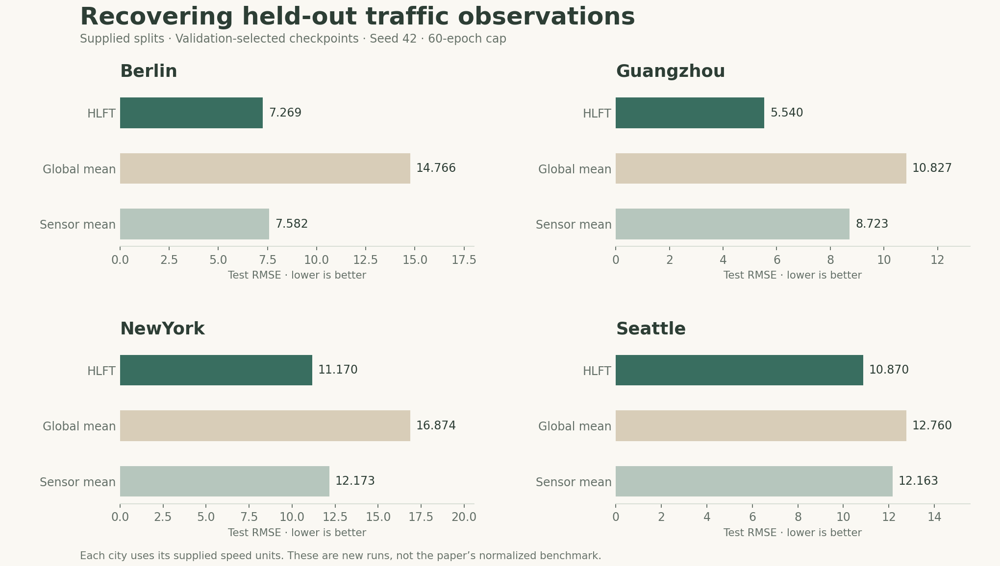
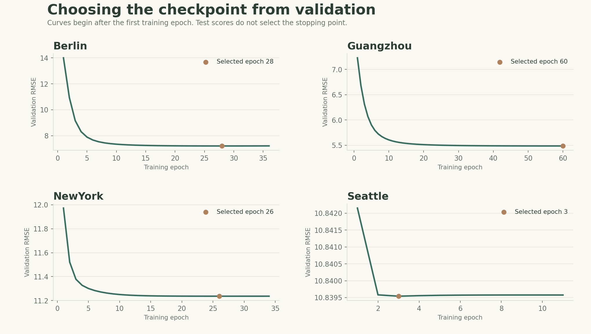

<p align="center"></p>

<p align="center"><a href="#overview">Overview</a> &nbsp;·&nbsp; <a href="#results">Results</a> &nbsp;·&nbsp; <a href="#getting-started">Getting started</a> &nbsp;·&nbsp; <a href="#publication">Publication</a></p>

<p align="center"><b>Hyperbolic tensor factorization</b> &nbsp; / &nbsp; Four traffic datasets &nbsp; / &nbsp; Reproducible experiments</p>

## Overview

Traffic sensors do not always provide complete observations. HLFT estimates missing traffic speeds by learning shared structure across **sensors, time intervals, and days** in hyperbolic space.

This repository accompanies the published HLFT research and provides the supplied research data, the original implementation, and a cleaned command-line/notebook workflow. The model uses analytic gradients and Riemannian stochastic gradient descent inside the Poincare ball.

| Data | Method | Evaluation |
| :--- | :--- | :--- |
| Berlin, Guangzhou, New York, Seattle | Hyperbolic latent factors | Supplied 70/10/20 entry splits |
| Sparse sensor × interval × day observations | Norm-adaptive Riemannian SGD | Checkpoint selected by validation RMSE |
| Twelve compressed split files included | Rank-20 factors by default | Final test RMSE, MAE, and MAPE |

## Results

**A fresh verification run on the supplied data.** These results were generated from the cleaned implementation using seed 42, rank 20, a maximum of 60 epochs, and validation patience 8. Each city used every eligible entry in its supplied splits; there was no row subsampling. As in the original source, zero-valued speeds were omitted.

| Dataset | Training entries used | Test RMSE | Test MAE | Selected epoch |
| :--- | ---: | ---: | ---: | ---: |
| Berlin | 93,169 | 7.2689 | 5.3720 | 28 |
| Guangzhou | 64,945 | 5.5396 | 3.9859 | 60 |
| NewYork | 65,890 | 11.1701 | 8.7515 | 26 |
| Seattle | 1,188,381 | 10.8705 | 8.2158 | 3 |

Errors are in each dataset's supplied speed units. The New York default run excludes 10,865 training zeros, 1,542 validation zeros, and 3,122 test zeros. This is an explicit source-code convention, not an assertion that stopped traffic is missing data. An alternative `--keep-zero` policy is available.

<p align="center"></p>

HLFT has lower test RMSE than the global-mean and sensor-mean reference baselines in this run. The advantage is not uniform across metrics: Seattle's sensor-mean baseline has slightly lower MAE. These two simple baselines are newly supplied references, not the five graph baselines evaluated in the paper. See [all measured metrics](results/verification_metrics.csv).

<details>
<summary><b>View the validation curves</b></summary>

<p align="center"></p>

Early stopping and checkpoint selection use validation observations only. The Guangzhou run reaches the 60-epoch cap; convergence is not claimed. Test observations are evaluated only at the selected checkpoint.

</details>

**Paper results use a different scale.** The article reports normalized errors; for example, its Seattle HLFT RMSE is 0.1239, compared with 0.1373 for GC_MC. The cleaned source-code workflow follows the supplied log10(speed+1) training transform and converts predictions back to dataset units. The numbers above are therefore not a numerical replication of that normalized comparison. Details and implementation corrections are documented in [method notes](docs/METHOD.md).

## Getting started

**1. Set up Python**

Use Python 3.11 or 3.12, preferably in a virtual environment.

```bash
python -m pip install -r requirements.txt
```

**2. Run one city**

The included .txt.gz files are read directly. No manual decompression or external dataset download is required.

```bash
python hlft.py --dataset Guangzhou --max-epochs 100
```

**3. Run all four cities**

```bash
python hlft.py --dataset all --max-epochs 100
```

To repeat the settings of the included verification run:

```bash
python hlft.py --dataset all --max-epochs 60 --patience 8 --seed 42
```

Prefer a notebook? Open [HLFT_Traffic_Imputation.ipynb](HLFT_Traffic_Imputation.ipynb) from the project folder. It contains the same core implementation and an editable configuration cell.

**4. Inspect the outputs**

| File | Contents |
| :--- | :--- |
| `summary.csv` | Final HLFT and baseline metrics by city |
| `history.csv` | Validation trajectory for every training epoch |
| `model.npz` | Best-checkpoint factors, ID maps, scale, and transform |
| `prediction_sample.csv` | Seeded sample of held-out predictions |
| `run_metadata.json` | Configuration, versions, data counts, hashes, and timing |

New runs write to `outputs/`. Included verification artifacts are stored separately under [results/verified](results/verified).

Regenerate the README figures from the recorded run:

```bash
python plot_results.py
```

For figures from a new run, use `python plot_results.py --run-dir outputs --output outputs/figures`.

## Data and reproducibility

The data contains records of the form `sensor_id::interval_id::day_id::speed`. All four datasets were checked for duplicate entries and train/validation/test overlap. Original text contents are preserved inside deterministic gzip files, with hashes in [the data manifest](data/manifest.json).

- [Data format, split counts, and zero-value policy](docs/DATA.md)
- [Measured dataset audit](results/dataset_audit.csv)
- [Original research source](reference/original_hlft.py)
- [Numerical and pipeline checks](tests/test_hlft.py)

```bash
python -m unittest discover -s tests -v
```

Twelve checks passed, including finite-difference checks of the distance and complete loss gradients, radial projection, split integrity, transforms, and a descent-step check. The original script's test-based stopping rule was changed to validation-only selection. This experiment addresses **missing entries**, not future forecasting or entire sensor-outage recovery.

## Publication

**Latent Factorization of Tensors in Hyperbolic Space for Spatiotemporal Traffic Data Imputation**  
*IEEE/CAA Journal of Automatica Sinica*, 13(8), 1991–1993, August 2026.  
[DOI: 10.1109/JAS.2024.124911](https://doi.org/10.1109/JAS.2024.124911) · [Read the paper](paper/HLFT_paper.pdf) · [Citation](CITATION.cff)

## Maintainer

**[Zhetao Zhang](https://github.com/ZhetaoZhang998)**
